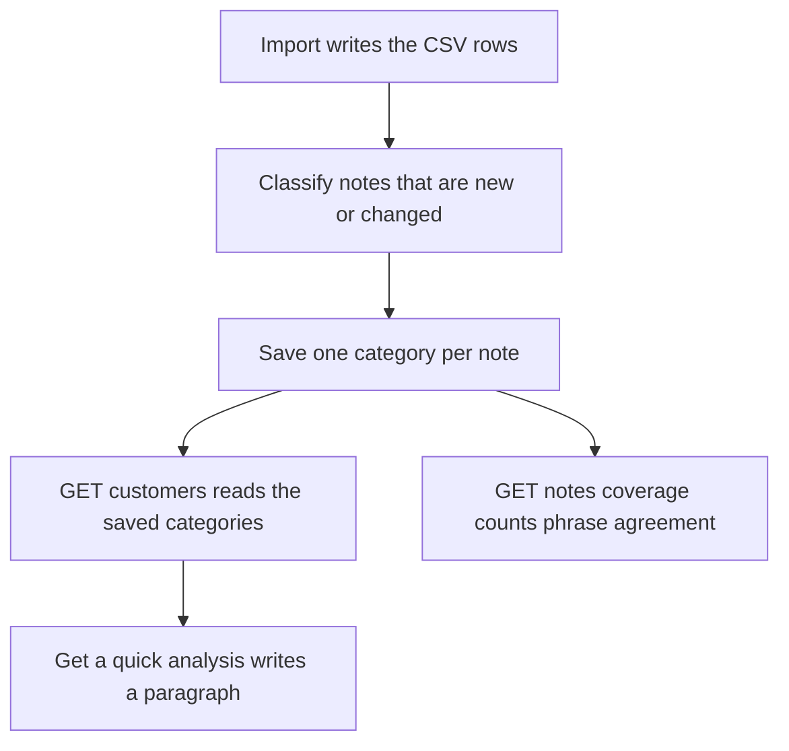

# How the model is used

The billed total is calculated in code. The model does not see invoices and does not calculate money.

## Notes

`pnpm run data:import` loads the CSV files, then classifies notes. The classifier lives in the API, not in the pipeline package, so the CSV load can run without a model key. Without `AI_API_KEY`, the import finishes and prints that classification was skipped.

The model receives a note id and the note text. It returns one category from a closed list and one sentence. A category outside the list is dropped. The result is stored in `NoteClassification`, keyed by the exported note id and the model. A later import classifies a note again only when its text changed.

Opening Accounts reads those saved rows. It does not call the model. The Note tag on an account is the saved category. The Quote column is the original note text. If several linked notes belong to one account, the strongest category stays. A note held between two customer ids is classified and counted, and it does not put a tag on either row.

## The phrase count

`GET /notes/coverage` compares saved categories with phrases already in the note text, such as Therma-Serv or prospect meeting. The message looks like "Agrees with known phrases on 119 of 152 notes." That number is calculated on the request. It is not stored, and it does not change the tag. Accounts shows the message under the title. The notes where the phrase and the model disagree are the ones to read in the quote before trusting the tag.

## Quick analysis

Get a quick analysis runs only when the button is clicked. It receives figures and tag counts that are already calculated. If the paragraph cites an amount that is not in those figures, the paragraph is discarded and not saved. A ready paragraph is saved for that same text, so the next click does not call the model again. The button does not classify notes.
